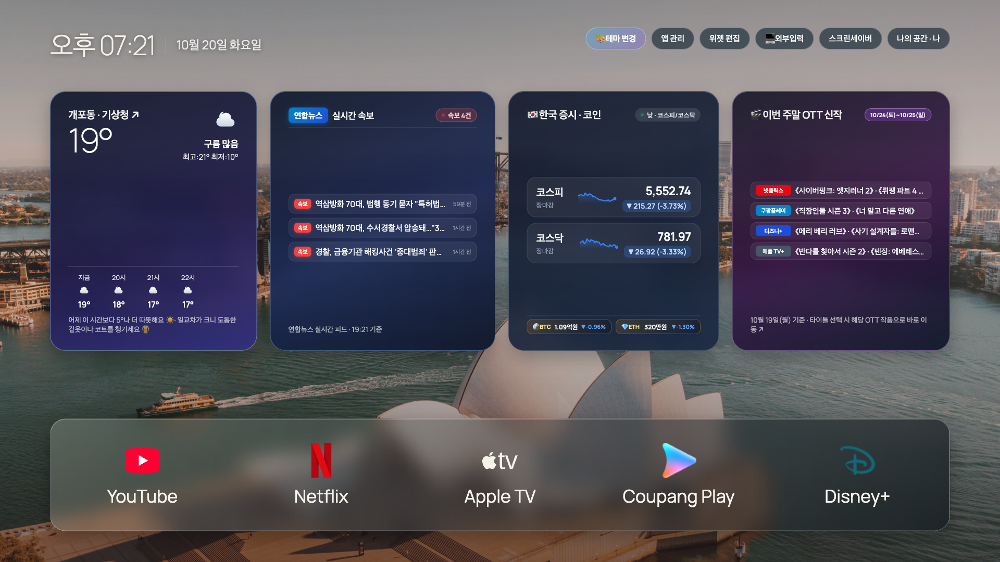

# Clean M7

삼성 Smart Monitor M7용 한국어 Tizen 홈 런처. 사진 배경, 즐겨찾는 스트리밍 앱, 날씨·뉴스·증시·OTT 위젯을 리모컨으로 사용합니다.

> 현재 소스 기준: **3.1.0** (`app/config.xml`). Gemini 작업 이후 소스를 다시 확인해 정리한 공개용 스냅샷입니다. HTML의 자산 캐시 버전 `320`과 패키지 버전은 서로 다릅니다. Samsung 공식 제품이 아닙니다.



## 주요 기능

- YouTube, Netflix, Apple TV, Coupang Play, Disney+ 도크. 앱 순서 변경·숨기기, 리모컨 방향키·확인·뒤로 지원.
- 위젯은 헤더와 앱 도크 사이에 배치. 최대 4개 선택, 순서·너비 조절. 기본은 날씨·뉴스·증시·OTT.
- 날씨: SVG 아이콘, 시간별 기온 곡선, 주간 최저·최고 막대, 체감온도·대기질·바람·습도·자외선·일출·일몰 상세. 현재 날씨와 낮·밤에 따른 배경 전환.
- 뉴스: 연합뉴스 RSS, 분야별 상세 및 대기화면 하단 티커. X 트렌드는 제거됨.
- 증시: 낮에는 코스피·코스닥, 밤에는 S&P 500·나스닥. 한국·미국·코인 고정 모드, 스파크라인, BTC·ETH 시세도 구현.
- OTT: 플랫폼별 추천·신작 목록, 콘텐츠 링크 실행 시도, 상황별 추천 룰렛.
- 테마: CleanFrame에서 가져온 사진 15종과 단색 2종. 유리 재질 3종, 도크 아이콘·이름 표시, 배경 순환·야간 어둡게.
- Manrope 산세리프 / Playfair Display 세리프 시계 글꼴 선택, 강화된 포커스 효과.
- 나·가족·게스트 프로필별 설정 저장. 2분 유휴 후 인앱 대기화면, 사진·날씨·미니멀 모드와 뉴스 티커.

**미완성 메뉴:** 외부입력 카드는 현재 앱 종료만 수행하며 USB-C/HDMI를 지정하지 않습니다. 취침 예약 버튼은 안내 문구만 표시하며 전원 타이머가 없습니다.

**데이터 한계:** 증시는 30초 간격 폴링이며 거래소 직결 실시간 피드가 아닙니다. 제공처 지연·휴장·캐시가 있을 수 있습니다. 주야간 전환은 장 개장 달력이 아니라 기기 시계의 07:00–19:59/20:00–06:59 구분입니다. TV 시간대를 한국으로 설정하세요. OTT는 고정 목록과 외부 조회가 섞여 있으며 일정·출연진·작품 링크가 검증되지 않았습니다. 날씨에도 누락 값의 대체값이 남아 있습니다. 상세 한계는 [데이터 문서](docs/data-sources.md)를 확인하세요.

## 시작하기

Python 3.10+로 브라우저 미리보기:

```sh
python3 -m http.server 18765 --bind 127.0.0.1 --directory app
```

별도 터미널에서 데이터 브리지 실행:

```sh
python3 scripts/news-server.py
```

브라우저에서 <http://127.0.0.1:18765>를 엽니다. 방향키·Enter·Escape로 조작합니다. 브라우저는 스트리밍 앱을 실행하지 않습니다. 첫 데이터 조회는 여러 외부 요청 때문에 느릴 수 있습니다.

TV 설치 전 `app/config.js`의 `bridgeUrl`을 **자신의 Mac LAN 주소**로 변경하세요. 공개본은 루프백 주소만 포함합니다. 인증서와 서명 패키지는 각자 생성해야 합니다.

- [설치·설정·원복](docs/setup.md)
- [기능·리모컨·설정 설명](docs/features.md)
- [데이터 제공처·갱신 주기·알려진 한계](docs/data-sources.md)
- [구조·검증 기록·Gemini 작업 반영](docs/development.md)
- [라이선스·자산 출처](THIRD_PARTY_NOTICES.md)

## 기기 확인 범위

참고 기기는 Samsung **LS32DM703UKXKR**, 사용자 확인 펌웨어 **2131**, SDB 보고 **Tizen 9.0 / ARM32**입니다. 앞선 설치본에서 앱 실행·Home 복귀·날씨·뉴스 위젯은 사용자 확인이 있었습니다. 최신 3.1.0 소스의 모든 화면과 링크를 실제 TV에서 재검증한 것은 아닙니다. 다른 모델·펌웨어는 검증되지 않았습니다.

앱 설치와 리모컨 Home 지정은 별개입니다. Home 변경은 기기별 비공개 API에 의존하므로 개인 기기 제어·복구 스크립트는 이 공개본에 포함하지 않았습니다. 앱은 수동 실행할 수 있습니다. 시스템 파일 삭제나 자동 디블로트 기능은 제공하지 않습니다.

## 공개 범위

원본 작업 폴더의 인증서·비밀번호·API 키·개인 IP·DUID·실기기 백업·로그·SDK·서명 WGT는 제외했습니다. 실행 중인 개인 TV와 서비스 설정은 변경하지 않았습니다. 공개본에만 브리지 주소 설정을 분리했습니다.

본 프로젝트는 [CleanFrame](https://github.com/nthnclrk/CleanFrame)의 테마·디자인 자산을 사용하며, 최초 아이디어는 [CleanYourTV](https://github.com/Gathin23/cleanyourtv)를 참고했습니다. CleanYourTV는 Android용이며 이 프로젝트는 Tizen 구현입니다. 코드와 자산의 라이선스 범위는 [LICENSE](LICENSE), [THIRD_PARTY_NOTICES.md](THIRD_PARTY_NOTICES.md)를 따릅니다.
