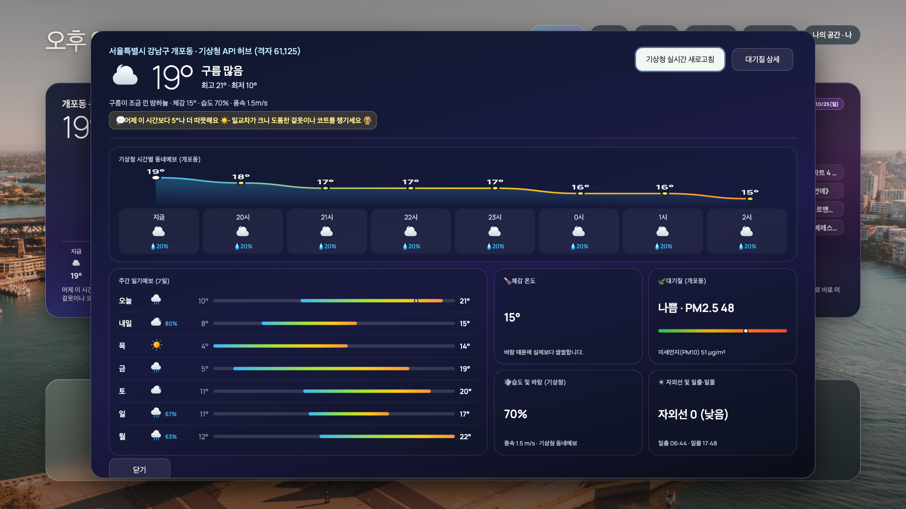
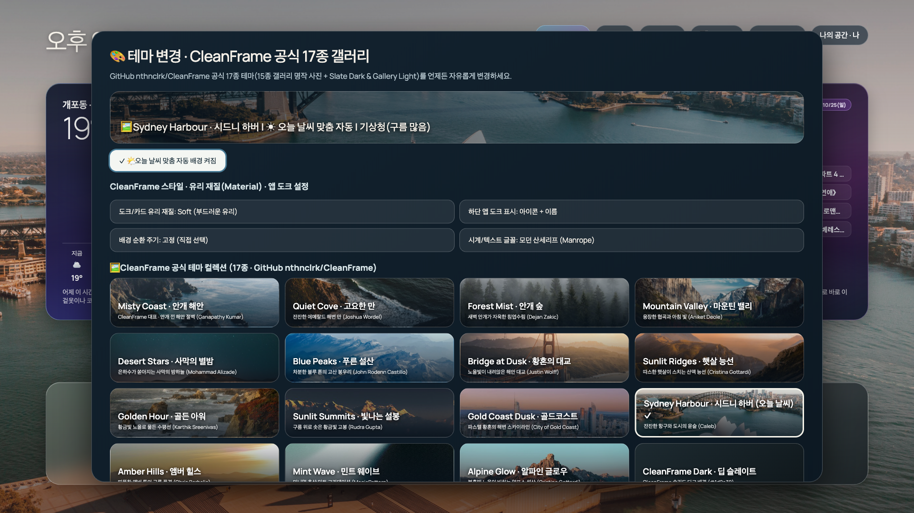
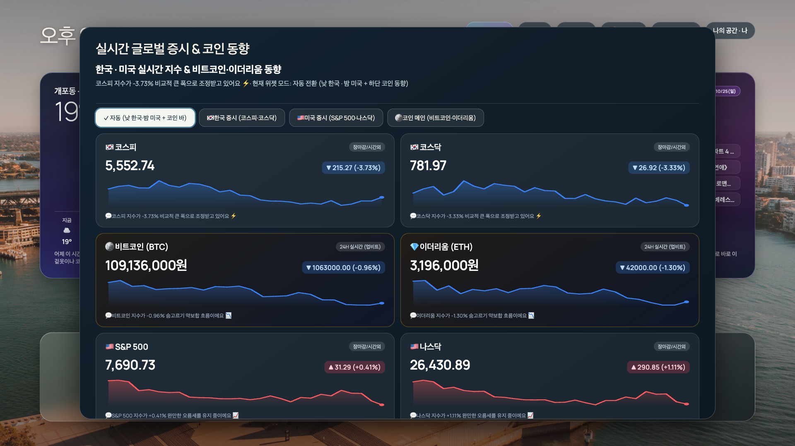

# 기능과 조작

## 메인 화면

시계·설정 메뉴 → 위젯 → 앱 도크 순서입니다. 큰 앱 제목과 설명 히어로는 제거되어 있습니다. 위젯은 최대 4개이며 날씨, 뉴스, 증시·코인, OTT, 미세먼지, 큰 시계, 최근 실행 중 선택합니다. 최근 실행은 기본 목록에서 증시로 교체됐지만 선택 가능한 종류로 남아 있습니다.

- 좌우: 현재 행에서 선택.
- 위: 앱 → 위젯 → 상단 설정.
- 아래: 반대 순서.
- 확인/Enter: 실행·상세·설정.
- 뒤로/Escape: 상세 닫기. TV 메인에서는 앱 종료 동작이 있으므로 기기에서 확인하세요.
- 대기화면의 첫 입력: 대기화면을 닫습니다.

## 앱 관리

앱별 아이콘·이름·순번, 왼쪽/오른쪽 이동, 홈에서 숨기기를 제공합니다. 숨기기는 앱 삭제가 아닙니다. 설치 앱 조회 API로 기본 다섯 서비스와 매칭합니다. 다른 서비스를 추가하려면 `main.js`의 catalog와 로고·매칭 규칙을 수정해야 합니다.

## 화면 꾸미기

현재 컬렉션은 사진 15종 + 단색 Dark/Light 2종, 총 17종입니다. 기존 여섯 사진 파일은 남아 있지만 현재 테마 선택 목록은 CleanFrame 컬렉션입니다.

- 재질: Soft / Frost / Clear Tint.
- 도크: 아이콘+이름 / 아이콘만 / 텍스트만.
- 배경: 날씨 자동 / 직접 선택 / 홈 열 때마다 / 5·15·60분 순환.
- 야간 어둡게, 대기화면 동기화, 하단 뉴스 티커.

화면 문구의 ‘공식 테마’는 CleanFrame 출처를 가리키는 현재 구현 문구이며 Samsung 또는 원저자의 본 프로젝트 보증을 뜻하지 않습니다. 테마에 붙인 지명은 별도 확인되지 않았습니다.

## 날씨 상세

Apple 날씨의 정보 구성을 참고한 독자적 SVG·카드 UI입니다. 시간별 곡선, 주간 온도 범위, 대기질과 체감온도, 바람·습도·일출일몰 등을 표시합니다. 기본 데이터 지역은 서울 강남구 개포동으로 코드에 고정돼 있습니다. 위치 센서나 사용자 위치 자동 추적은 없습니다. 다른 지역으로 바꾸려면 프런트엔드·브리지의 좌표, 기상청 격자 및 RSS 지역을 함께 변경해야 합니다.

## 프로필과 대기화면

나·가족·게스트는 TV 로컬 저장소에 설정·앱 순서·위젯 구성을 저장하는 프로필이며 계정이나 보안 경계가 아닙니다. 대기화면은 앱 내부 기능으로 Samsung 시스템 화면 보호·절전 설정을 대체하지 않습니다. 기본 유휴 시간은 2분입니다. 날씨 배경, 사진 1분 순환, 홈 동기화, 올블랙 모드와 티커 속도를 설정합니다.

## 현재 소스의 브라우저 화면

실기기 사진이 아닌 브라우저 미리보기입니다. 데이터·문구의 검증 한계는 데이터 문서를 참조하세요.

### 날씨 상세

### 테마 설정

### 증시 상세

## 추가 확인: 글꼴·외부입력·취침 예약

시계는 Manrope 산세리프 또는 갤러리 세리프를 선택합니다. 세리프는 Google Fonts의 Playfair Display를 원격 요청하고 실패하면 기기 폰트로 대체합니다. 오프라인에서 같은 모양을 보장하지 않습니다.

외부입력 메뉴에는 USB-C·HDMI 1·HDMI 2·삼성 소스 바 카드가 있지만, 현재 선택 핸들러는 Tizen 앱 종료만 실행합니다. 입력 전환 API 호출은 없습니다. ‘30분 취침 예약’도 상태 메시지만 표시하고 실제 타이머·전원 제어를 하지 않습니다. **두 메뉴는 미완성 UI입니다.**

대기화면의 사진 작가·장소 캡션 표시 여부도 선택할 수 있습니다.
